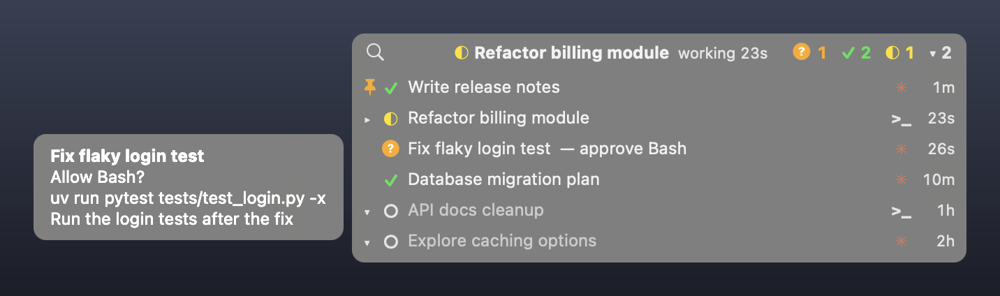

# agent-hover

[English](README.md)

在 **iTerm2** 裡只顯示少數幾個 AI 程式代理分頁。其他代理分頁會隱藏並繼續執行，需要你時再自己回來。一個小型浮動面板讓你一眼看到所有代理。支援 macOS 上的 Claude Code 與 Codex。



- **讓分頁列保持簡短。** 工具最多只顯示 N 個代理分頁。其他分頁會變成 iTerm2 的 **buried sessions**（隱藏工作階段），程式仍在背景執行。
- **需要時分頁會自己回來。** 代理等你回覆或完成工作時，它的分頁會回到原本的位置。但你打字時不會。
- **一眼看到所有代理。** 螢幕右上角的小膠囊顯示最近活動的代理。滑鼠移上去，就會列出所有代理分頁：工作中、等你回覆、已完成、閒置。點一下就會把該分頁和 iTerm2 帶到最前面。

> **狀態：概念驗證（POC）。** 作者每天在一台 Mac 上使用。可能還有不完善的地方。測試環境：macOS 15.8、iTerm2 3.7.3、Claude Code 2.1、Codex CLI。只支援 macOS 與 iTerm2。

## 功能

| 功能 | 說明 |
|---|---|
| 代理狀態 | Claude Code 與 Codex 的 hook 會寫入每個分頁的狀態：**工作中**、**等待中**（權限、提問、計畫）、**已完成**、**閒置** |
| N 個使用中分頁 | 背景程式會隱藏閒置或長時間工作的分頁；代理等待或完成時，再把分頁叫回來。它不會改分頁標題 |
| 浮動面板 | 滑鼠移到膠囊上，會依最近活動順序列出所有代理分頁。點一列就會叫出該分頁 |
| 問題預覽 | 等待中的代理有橘色 `?`。滑鼠移到該列，會顯示問題內容：要核准的指令、選項或計畫 |
| 偷看（Peek） | 滑鼠停在其他列上，會顯示該分頁畫面的最後幾行，不必切換過去 |
| 「新」圓點 | 藍色圓點標示已完成、但你還沒看過的分頁 |
| 釘選 | 在某列按右鍵 → **Pin**。釘選的分頁不會被隱藏，並排在最前面 |
| 搜尋 | 點放大鏡。可依分頁名稱、代理資料夾篩選，也可選擇搜尋對話內容 |
| 邊緣細條 | 把膠囊拖到螢幕右邊緣，它會變成一條細條，顏色代表最緊急的狀態。滑鼠移上去就會展開面板 |
| 模型 | 滑鼠停在某列，會顯示代理與所用的模型（也包含自訂供應商，例如 Codex 接本機模型） |
| 安全輸入 | 自動叫回分頁前，會等你停止打字 3 秒，避免按鍵送到錯的代理 |
| 設定 | `~/.agent-hover/config.json`：字型大小、面板寬度、N、閒置時間 |

## 需求

- macOS（測試於 15.8）與 **iTerm2 3.7 以上**，並開啟 Python API（**Settings → General → Magic → Enable Python API**）。
- [uv](https://docs.astral.sh/uv/)（Python 套件管理工具）。
- Xcode Command Line Tools（`xcode-select --install`）。面板是一個 Swift 檔，第一次執行 `./run.sh panel` 時會在你的 Mac 上編譯。所以不需要下載未簽署的 App。
- Claude Code 和／或 Codex CLI。

`./run.sh doctor` 會檢查以上所有項目，並為每個問題提供修正方法。

## 安裝

1. 取得程式碼：
   ```sh
   git clone https://github.com/scsnake/agent-hover.git
   cd agent-hover
   ```
2. 先看安裝會改什麼。這一步不會寫入任何檔案：
   ```sh
   ./install.sh
   ```
3. 加入 hook。它會先備份 `~/.claude/settings.json` 與 `~/.codex/config.toml`：
   ```sh
   ./install.sh --apply
   ```
4. 只有 Codex 需要：啟動 `codex`，輸入 `/hooks`，信任新的 hook。Codex 會略過未信任的 hook。
5. 先用 **dry run**（試跑）啟動背景程式。它只記錄會做什麼：
   ```sh
   ./run.sh start
   ./run.sh log
   ```
6. 確認決定合理後，正式啟動背景程式與面板：
   ```sh
   ./run.sh stop
   ./run.sh            # 等同 ./run.sh up
   ```
7. 選用：登入時、以及每次 iTerm2 執行時自動啟動：
   ```sh
   ./run.sh autostart on
   ```
   macOS 可能會詢問一次是否允許它控制 iTerm2，請允許。`./run.sh autostart off` 可移除。

請在一般的 shell 分頁啟動背景程式，不要在代理的工作階段裡啟動。

## 使用

| 動作 | 結果 |
|---|---|
| 滑鼠移到膠囊上 | 展開清單 |
| 滑鼠移開 | 0.4 秒後收起清單 |
| 點某列，或點膠囊 | 該分頁回來（若被隱藏）並被選取，iTerm2 移到最前面 |
| 滑鼠停在等待中的列 | 清單旁的小框顯示代理的問題 |
| 滑鼠停在其他列 | 0.35 秒後，小框顯示該分頁畫面的最後幾行（偷看） |
| 在某列按右鍵 | **Pin** / **Unpin**（釘選／取消釘選） |
| 點放大鏡 | 搜尋模式：輸入文字即篩選。勾選 **chat** 可搜尋對話內容。**Enter** 叫出第一個分頁；**Esc** 結束搜尋 |
| 拖曳膠囊 | 移動面板。放到螢幕右邊緣就會變成邊緣細條 |

面板只顯示在第一個桌面空間（Space）。在其他空間與全螢幕 App 上會隱藏。

終端機裡也能用同樣的搜尋：`./run.sh search [--chat] 關鍵字`。

## 規則：分頁何時隱藏、何時回來

背景程式每秒檢查一次。

- **回來：** 代理在**等你**，或已**完成**但你還沒看過。代理結束時也會回來。
- **隱藏：** **工作中**的分頁，在你離開 120 秒後；**已完成**（看過）或**閒置**的分頁，在 20 分鐘後。
- **分頁太多：** 顯示的代理分頁超過 N（5）個時，先隱藏閒置的，再來是已完成的，最後是工作中的。
- **永不隱藏：** 你正在用的分頁、每個視窗目前選取的分頁、等待中的分頁、釘選的分頁、視窗的最後一個分頁、有分割窗格的分頁。
- **打字時不打擾：** 自動叫回分頁前，會等到 3 秒內沒有按鍵。之後，你打字的視窗會拿回鍵盤焦點。

安裝前就啟動的代理分頁，會在 5 秒內依程式名稱（`claude`、`codex`）被找到。

其他分頁（shell、SSH、其他程式）完全不會被動到。

## 設定

把 `config.example.json` 複製到 `~/.agent-hover/config.json`，再修改需要的項目：

```json
{
  "panel":  {"font_size": 12, "list_width": 440},
  "daemon": {"n_active": 5, "idle_min": 20, "working_park_s": 120},
  "agents": {"extra": []}
}
```

- `panel` 的變更 1 秒內生效。`daemon` 的變更要執行 `./run.sh stop` 與 `./run.sh start --apply` 後才生效。
- 命令列參數會覆蓋設定檔，例如 `./run.sh start --apply --n 8`。
- `agents.extra`：要額外辨識的程式名稱（例如 `qwen`）。這類代理也需要設定 hook，以 Claude 格式的事件呼叫 `agent_hover/hook.py <名稱>`。
- 代理標記：`~/.agent-hover/agents.json`，例如 `{"codex": {"mark": "◇", "color": "#10A37F"}}`。

## 指令

| 指令 | 作用 |
|---|---|
| `./run.sh` 或 `./run.sh up` | 啟動背景程式（`--apply`）與面板 |
| `./run.sh down` | 停止面板與背景程式（會先叫回它隱藏的分頁）。也會暫停自動啟動，直到下次 `up` |
| `./run.sh doctor` | 檢查設定，並為每個問題提供修正方法 |
| `./run.sh autostart on` / `off` / `status` | 登入時與 iTerm2 執行時自動啟動（LaunchAgent）；`off` 會移除 |
| `./run.sh start [--apply]` | 只啟動背景程式。沒有 `--apply` 時是試跑 |
| `./run.sh stop` | 只停止背景程式。停止前會叫回它隱藏的所有分頁 |
| `./run.sh status` | 模式、隱藏數量、最後幾行記錄 |
| `./run.sh restore` | 叫回它隱藏的所有分頁（當機後也可用） |
| `./run.sh log` | 持續顯示決策記錄 |
| `./run.sh panel` / `panel-stop` | 啟動／停止面板 |
| `./run.sh search [--chat] 關鍵字` | 依名稱、資料夾、對話內容找代理分頁 |

## 會改什麼，以及如何復原

- **Hook：** 在 `~/.claude/settings.json` 加入有標記的項目，在 `~/.codex/config.toml` 加入有標記的區塊。這兩個檔案的其他內容不會變。安裝前會先備份到 `~/.agent-hover/backup/<時間>/`。
- **資料：** `~/.agent-hover/` 存放狀態檔、記錄、釘選與備份。只有你的使用者帳號能讀取。
- **自動啟動（只有你開啟時）：** `~/Library/LaunchAgents/local.agent-hover.plist`。
- **iTerm2：** 它會隱藏與叫回代理分頁，並把叫回的分頁移回原位。iTerm2 內建的 Claude Code 整合不會被更動。

復原方式：

```sh
./uninstall.sh                        # 試跑：顯示會移除什麼
./uninstall.sh --apply                # 移除自動啟動、停止、叫回所有分頁、只移除本工具的 hook
./uninstall.sh --restore-backup       # 試跑：還原安裝前的原始檔案
./uninstall.sh --restore-backup --apply
```

**注意：** 搭配 `--restore-backup` 使用 `--force` 前請先讀這段。如果檔案在安裝後有變動，還原會拒絕執行，以保護之後的修改。`--force` 會強制還原，那些修改會遺失。

## 隱私

所有資料都留在你的 Mac 上，不會連網。

- hook 會儲存每個代理的狀態、資料夾，以及待回覆問題的文字。
- 對話搜尋與模型提示會讀取代理自己的對話紀錄檔（`~/.claude/projects`、`~/.codex/sessions`），只在你搜尋時，或針對目前開著的分頁讀取。
- 偷看功能透過 iTerm2 讀取滑鼠所指分頁的畫面，並把最後幾行存在 `~/.agent-hover/peek.json`。

## 運作方式

```
Claude Code / Codex hooks ──► ~/.agent-hover/state/<分頁>.json
                                        │
                     背景程式（iTerm2 Python API，每秒一次）
                       │ 規則：隱藏／叫回             │ 寫入 panel.json
                       ▼                             ▼
                 iTerm2 分頁                  浮動面板（Swift）
                                             點擊 ──► requests/ ──► 背景程式
```

| 檔案 | 用途 |
|---|---|
| `agent_hover/hook.py` | hook 本體。只用標準函式庫，一律以 0 結束，不輸出任何內容 |
| `agent_hover/states.py` | hook 事件 → 狀態；狀態檔；問題文字 |
| `agent_hover/rules.py` | 何時隱藏與叫回（純邏輯） |
| `agent_hover/daemon.py` | iTerm2 背景程式 |
| `agent_hover/search.py` | 依名稱、資料夾、對話搜尋；從對話紀錄讀出模型 |
| `agent_hover/config_edit.py` | 安裝、移除、還原 hook 項目 |
| `panel/AgentHoverPanel.swift` | 浮動面板 |

測試：`uv run pytest`。端對端測試 `tests/e2e_sandbox.py` 會開一個測試視窗與假的代理分頁。**請先停止背景程式**（`./run.sh stop`）。

## 限制

- 只支援 macOS 與 iTerm2。只有 iTerm2 能隱藏分頁並讓它繼續執行。
- 預設只支援 Claude Code 與 Codex。
- 不追蹤遠端代理（SSH + tmux）。
- 有分割窗格的分頁會列出，但不會被隱藏或移動。
- 面板與背景程式依賴 iTerm2 與 macOS 的行為，未來版本可能改變。例如空間檢查使用 macOS 私有呼叫；若失敗，面板就會在每個空間顯示。

## 相關專案

很多工具都能顯示代理狀態。就我們所查（2026 年 10 月），沒有一個會隱藏並叫回 iTerm2 分頁。請依你的使用方式挑選：

| 工具 | 介面 | 代理 | 隱藏分頁 | 說明 |
|---|---|---|---|---|
| **本工具** | 浮動面板 + iTerm2 分頁管理 | Claude Code、Codex | **會**（顯示 N 個，其餘隱藏） | 不改分頁標題；你打字時會等待 |
| [iTerm2 3.7 內建](https://iterm2.com/claude-code-integration.html) | iTerm2 的 Session Status | Claude Code | 不會 | 原生功能；狀態點、說明列、點擊跳轉。本工具可與它並存 |
| [Megadesk](https://github.com/saugon/megadesk) | 浮動面板 + 選單列 | Claude Code、Codex | 不會 | 可聚焦 iTerm2 與 Ghostty 的分頁或窗格；快捷鍵；PR/CI 追蹤 |
| [cc-status-bar](https://github.com/usedhonda/cc-status-bar) | 選單列 | Claude Code、Codex | 不會 | 可自動聚焦等待中的終端機；快捷鍵跳到最緊急的工作階段 |
| [CodeIsland](https://github.com/wxtsky/CodeIsland)、[Notchi](https://github.com/sk-ruban/notchi) | MacBook 瀏海 | 多種 | 不會 | 可在瀏海上核准或回答 |
| [cmux](https://github.com/manaflow-ai/cmux) | 自己的終端機（基於 Ghostty） | 任何 | — | 垂直分頁、通知光圈。適合想換新終端機的人 |

代理事件的設計參考了 [agent-board](https://github.com/WenyuChiou/agent-board)（給多個代理共用的進度看板）。

## 授權

MIT。請見 [LICENSE](LICENSE)。
